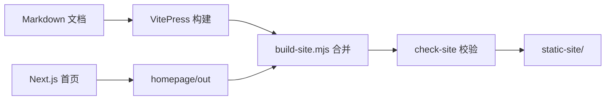

# 模板介绍

这是一套开箱即用的项目文档站模板：**官网首页 + 文档站** 一次构建、一份部署产物。写作只用 Markdown，构建、检查、部署脚本已经就位，克隆后改几个配置就能换成自己的项目。

本页说明模板包含什么、目录怎么组织、第一次使用时改哪些地方。

## 模板包含什么 {#whats-included}

| 部分 | 技术 | 作用 |
| --- | --- | --- |
| 文档站 | VitePress 1.x | 分类侧边栏、本地中文搜索、目录页、深浅色、Mermaid |
| 官网首页 | Next.js App Router（静态导出） | 区块式首页、截图轮播、响应式、与文档站共用顶栏 |
| 主题 | Vite + CSS 变量 | 品牌色、字体、排版、代码块、表格滚动容器 |
| 构建脚本 | Node.js | 合并两个应用、校验链接/锚点/资源、输出 `static-site/` |
| 质量门禁 | Node.js + Playwright | 死链、Mermaid 语法、产物断言、端到端交互检查 |
| 部署配置 | 工作流 + Nginx | GitHub Pages、Docker、静态文件 |

## 目录结构 {#layout}

```text
.
├── site.config.json        # 站点身份与导航（改这里）
├── 01-getting-started/     # 文档分类目录：每个目录一个侧边栏分组
├── 02-architecture/
├── 03-features/
├── 04-api/
├── 05-clients/
├── 06-development/
├── 07-releases/            # 每版一页，侧边栏按版本号倒序
├── homepage/               # Next.js 官网（文案集中在 app/content.ts）
├── .vitepress/             # 文档站配置与主题
├── shared/                 # 品牌变量、顶栏图标（官网与文档共用）
├── public/                 # logo、favicon、screenshots/
├── scripts/                # 构建、检查、预览、打包、发布、集成测试
└── deploy/、Dockerfile     # Nginx 与容器部署
```



## 第一次使用要改什么 {#first-run}

1. **`site.config.json`**：站点名称、标题、描述、仓库地址、分类顺序与每类入口页、必须存在的路由。
2. **`shared/brand.css`**：品牌色、纸张色、字体族（`--mh-*` 变量，深浅色各一组）。
3. **`homepage/app/content.ts`**：首页文案、区块卡片、截图轮播、部署说明、页脚。
4. **`public/logo.svg`、`public/favicon.ico`**：品牌标识。
5. **`public/screenshots/` 与 `homepage/public/docs/_home/product/`**：截图素材（模板里是占位图）。
6. **`VERSION` 与 `07-releases/`**：版本号与版本说明。
7. **`AGENTS.md`**：如果项目也用 AI 维护文档，把里面的映射表改成自己的目录。

改完执行：

```bash
npm run setup
npm run build
npm run preview
```

预览地址会在终端打印（默认 `http://127.0.0.1:3000/`）。

<Screenshot
  src="/screenshots/sample-01.png"
  caption="截图组件示例：图片放在 public/screenshots/，构建时按真实尺寸预留版面"
  hint="替换为产品主界面截图；缺图时这里会显示「截图待补充」占位。" />

## 写作只需要 Markdown {#markdown}

页面文件放进对应分类目录即可，文件名前的两位序号决定侧边栏顺序，一级标题（`#`）作为侧边栏文字。可用语法：

- 标题、段落、列表、引用、表格（自动包一层横向滚动容器）
- 代码块（按语言高亮）、行内代码
- 站内链接用相对 `.md` 路径，例如 [写作指南](02-writing-guide.md)
- `<Screenshot>` 组件插入截图
- ` ```mermaid ` 代码块画流程图

## 相关文档

- [写作指南](02-writing-guide.md)
- [开发指南](../06-development/01-dev-guide.md)
- [v0.1.0 版本说明](../07-releases/v0.1.0.md)
