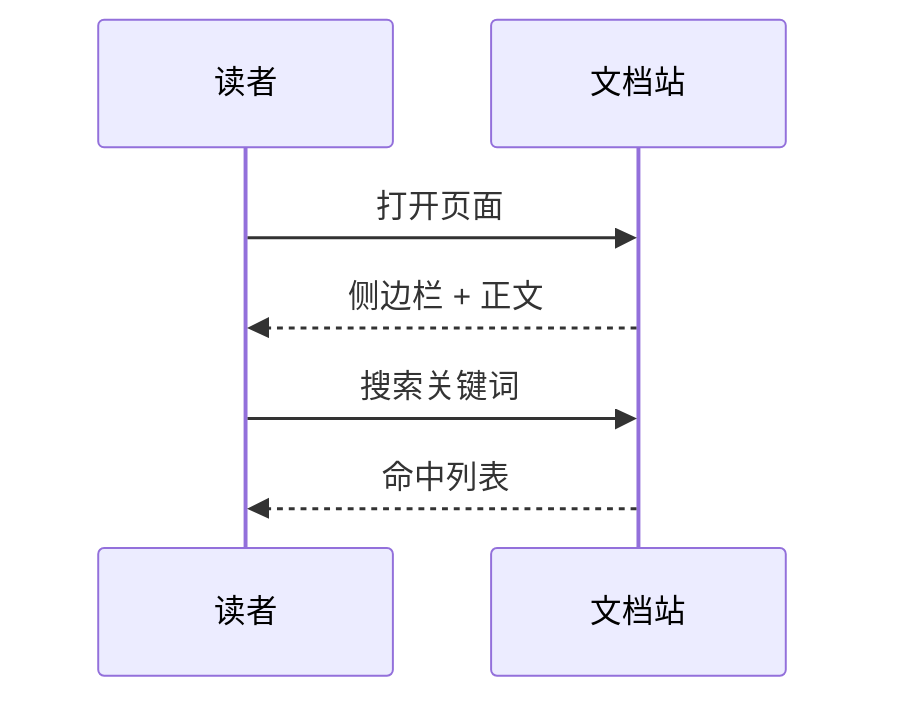

# 写作指南

本页是模板的写作约定与语法示例：照着写，构建脚本会自动检查链接、Mermaid 与锚点。

## 页面结构 {#structure}

每个页面按下面的骨架写，侧边栏与目录都会据此生成：

1. 第一行 `# 一级标题`（会作为侧边栏文字）。
2. 开头 1-3 段：这页解决什么问题、面向谁。
3. 4-8 个 `##` 章节；复杂内容再用 `###`。
4. 至少一张表格；流程或架构页至少一张 Mermaid。
5. 结尾可加 `## 相关文档`，链接相邻页面。

## 标题与锚点 {#anchors}

VitePress 会为标题自动生成锚点，但中文标题的锚点不稳定，建议给关键章节手写英文锚点：

```md
## 配置项 {#config}
```

之后就能链接到 `02-writing-guide.md#config`。`npm run check` 会校验锚点是否存在。

## 表格 {#table}

| 场景 | 写法 | 说明 |
| --- | --- | --- |
| 参数说明 | 三列表格 | 第一列放参数名，用行内代码 |
| 对比 | 两列 | 保持每行只讲一个维度 |
| 清单 | 多列 | 单元格内容尽量短 |

表格会被包一层横向滚动容器，宽表在窄屏上不会撑破版面。

## 代码块 {#code}

````md
```bash
npm run check:docs
```
````

- 标注语言（`bash`、`toml`、`json`、`ts`、`go`、`yaml`、`sql`），高亮与复制按钮由主题提供。
- 命令要可复制执行；占位符用 `<...>` 或 `$VAR`，并在上下文中解释。
- 单段源码建议不超过约 40 行，超出时写"入口在 `path`，职责是……"。

## 站内链接 {#links}

用相对 `.md` 路径，构建前由 `check-links.mjs` 校验：

```md
[快速开始](01-introduction.md)
[开发指南](../06-development/01-dev-guide.md)
[章节锚点](01-introduction.md#first-run)
```

只链接真实存在的页面；外部链接写完整 URL。

## 截图 {#screenshot}

图片放在 `public/screenshots/`，正文用组件引用：

```md
<Screenshot
  src="/screenshots/sample-02.png"
  caption="一句话说明这张图展示什么"
  hint="补图时应该拍到的界面元素" />
```

<Screenshot
  src="/screenshots/sample-02.png"
  caption="截图组件示例：caption 显示在图下方，hint 只在缺图时出现"
  hint="示例：产品设置页，展示模型选择与保存按钮。" />

组件会在构建时读取 PNG 的真实尺寸并预留版面，图片缺失时显示占位而不是破版。**图片必须是真实 PNG**：把 JPEG 直接改扩展名会让构建报 `Invalid PNG screenshot`。

## Mermaid {#mermaid}



- 支持 `flowchart`、`sequenceDiagram`、`stateDiagram-v2`、`erDiagram`。
- 节点文本含括号、冒号、斜杠时用引号包住：`A["文本（说明）"]`。
- `npm run check:mermaid` 会在构建前解析所有图，语法错直接失败。

## 行内特殊字符 {#escaping}

- 行内代码里可以出现 `{{placeholder}}` 这类双花括号，主题会自动按字面渲染。
- 正文里避免裸写 `{{`：会被 Vue 当成插值表达式。

## 自检 {#checks}

```bash
npm run check:links     # 站内链接与锚点
npm run check:mermaid   # Mermaid 语法
npm run check           # 上面两项 + 构建产物校验
npm run build           # 官网 + 文档 + 合并校验
```

## 相关文档

- [模板介绍](01-introduction.md)
- [开发指南](../06-development/01-dev-guide.md)
