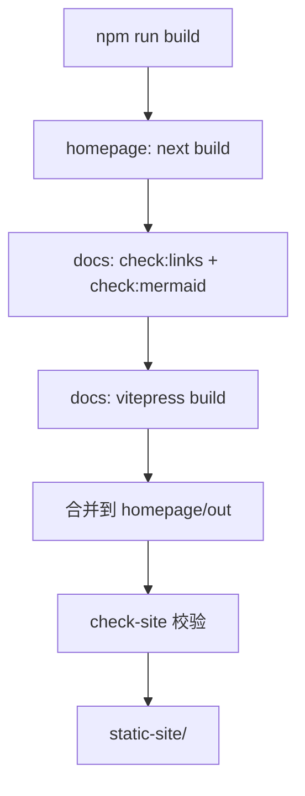

# 架构概览

这一页是架构类页面的骨架：说明系统由哪些部分组成、各部分如何协作。换成自己的项目时，把下面的示意替换为真实组件。

## 系统组成 {#components}

| 组件 | 技术 | 职责 |
| --- | --- | --- |
| 官网 | Next.js（静态导出） | 产品介绍、入口链接、截图展示 |
| 文档站 | VitePress | 正文、侧边栏、搜索、版本页 |
| 构建脚本 | Node.js | 合并两个应用、校验产物 |
| 部署 | Nginx / GitHub Pages | 静态文件服务 |

## 构建流程 {#pipeline}

## 请求路径 {#request-path}

静态站点没有服务端请求路径：浏览器直接取 `static-site/` 里的文件。部署到子路径时，构建期注入的前缀（`SITE_BASE`）决定所有链接与资源的实际地址。

## 目录约定 {#directories}

- 文档正文按分类放在 `01-…` 到 `07-…` 目录，文件名序号决定顺序。
- 官网代码在 `homepage/`，文案集中在 `homepage/app/content.ts`。
- 共享的品牌变量与顶栏图标在 `shared/`，两个应用都引用。

## 相关文档

- [模板介绍](../01-getting-started/01-introduction.md)
- [开发指南](../06-development/01-dev-guide.md)
