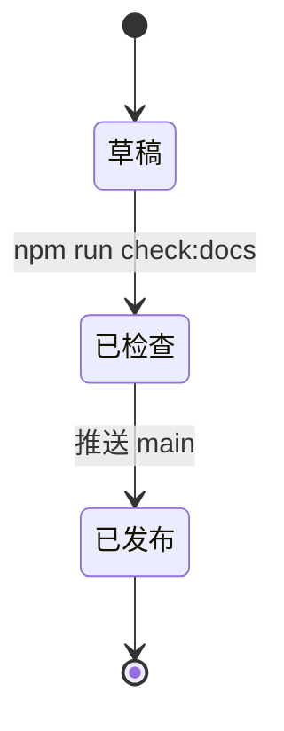

# 功能总览

这一页是功能类页面的骨架：按用户视角说明"能做什么、怎么用、边界在哪"。每个功能可以单独成页，也可以像本页一样先做索引。

## 功能清单 {#list}

| 功能 | 一句话说明 | 详细文档 |
| --- | --- | --- |
| 文档分类 | 目录即侧边栏，新增页面自动出现 | [写作指南](../01-getting-started/02-writing-guide.md) |
| 中文搜索 | 本地索引，按字粒度分词 | [写作指南](../01-getting-started/02-writing-guide.md#checks) |
| 截图组件 | 预留版面、缺图占位 | [写作指南](../01-getting-started/02-writing-guide.md#screenshot) |
| Mermaid | 流程图/时序图，构建前校验 | [写作指南](../01-getting-started/02-writing-guide.md#mermaid) |

<Screenshot
  src="/screenshots/sample-03.png"
  caption="功能页示例：需要真实界面时替换为产品截图"
  hint="示例：功能入口所在页面。" />

## 典型使用流程 {#flow}

## 边界与限制 {#limits}

- 静态站点不支持服务端搜索；本地搜索索引在构建时生成。
- 截图与图片会随构建产物一起发布，注意体积。
- 版本页按文件名排序，版本号需写成 `vX.Y.Z`。

## 相关文档

- [模板介绍](../01-getting-started/01-introduction.md)
- [API 总览](../04-api/01-api-overview.md)
