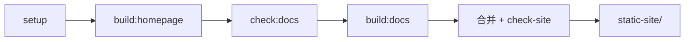

# 开发指南

这一页是开发类页面的骨架：写清本地怎么跑、脚本各自做什么、目录约定是什么。

## 环境要求 {#requirements}

| 依赖 | 版本 | 用途 |
| --- | --- | --- |
| Node.js | 22 或 24 LTS | 构建与脚本 |
| npm | 随 Node | 依赖管理 |

## 常用命令 {#commands}

| 命令 | 作用 |
| --- | --- |
| `npm run setup` | 安装根目录与 `homepage/` 依赖 |
| `npm run dev:docs` | 只跑文档站（热更新） |
| `npm run dev:homepage` | 只跑官网（热更新） |
| `npm run build` | 构建官网 + 文档并校验，输出 `static-site/` |
| `npm run preview` | 本地预览 `static-site/` |
| `npm run check` | 链接 + Mermaid + 产物校验 |
| `npm run test:integration` | 端到端检查（需本机 Chrome） |
| `npm run package:site` | 打包 `static-site/` 到 `releases/` |

## 构建流程 {#build}

## 目录职责 {#responsibilities}

- `scripts/build-site.mjs`：串起两个构建，合并产物并校验。
- `scripts/check-links.mjs` / `check-mermaid.mjs`：构建前检查。
- `scripts/check-site.mjs`：产物层面的路径、锚点、截图尺寸断言。
- `scripts/serve-site.mjs`：本地预览，支持 `SITE_BASE` 子路径。
- `.vitepress/config.mts`：站点配置、侧边栏、搜索分词、Mermaid 主题。

## 相关文档

- [模板介绍](../01-getting-started/01-introduction.md)
- [写作指南](../01-getting-started/02-writing-guide.md)
